# OpenCommons: Hardening and Scale Plan

> Status: Draft for your review. Once approved, this becomes the prompt for a second team project on `kardashev-cli`. That project starts after the reviewer commits the staged rename.
> Sources: [scaling research](opencommons_scaling_report.md) · [security research](opencommons_security_report.md) · code inspection of `src/kardashev_cli/opencommons.py`

## 1. Where it stands today (verified in code)

The seed library and local agent loop are solid. The **public hub is not safe to expose** yet:

| # | Finding | Evidence | Severity |
|---|---|---|---|
| 1 | Submitted code runs **inside the hub's own Python process** via `exec`. Nothing isolates it at the process level, and there are no CPU, memory or time limits. The only protection is a static AST check. One infinite loop ties up a hub thread forever. | `opencommons.py` L692, L811, L1214 | Critical |
| 2 | `POST` reads any `Content-Length` with no cap, then decodes gzip (decompression-bomb risk). There is no auth, no rate limit, and the number of threads is unbounded. | `create_opencommons_hub_server` L3531–3534, L3560 | Critical |
| 3 | Concept text (summary, pseudocode, pitfalls, code) goes **straight into agent prompts** with no delimiting or sanitizing. The turn-0 wrapper even calls it "peer-reviewed… reuse". | `render_for_agent` L926–969, `build_turn_zero_commons_context` L3908 | High |
| 4 | `contributor_agent` and other free-text fields from remote clients are stored and re-synced as is, so identifiers can leak into the public commons. | `process_hub_sync_request` L3345 | High |
| 5 | Remote clients can send `quarantined_ids` that affect how the hub stores blocks. | L3329, L3349 | Medium (needs a deeper check) |
| 6 | Every request loads and rewrites the whole `store.json` under one global lock: O(n) per request, a single writer. | `load/save_persistent_store` L2939–3000 | Scale blocker |
| 7 | The 16-bucket Merkle sync degrades: at 1M concepts, one bucket mismatch means diffing about 62k items. | `compute_merkle_manifest` L1250 | Scale blocker |
| 8 | Error responses echo `str(exc)` to callers, which helps attackers probe the filters. | L3544, L3557 | Medium |

## 2. Target architecture

```mermaid
flowchart LR
  subgraph Agents["Any coding agent: Claude Code, Codex, Cursor, Antigravity, kardashev"]
    X["Concept extractor + client-side minimizer"]
  end
  X -->|"submit + proof-of-work, anonymous key"| E["Edge API: size cap, rate limits, schema"]
  E -->|"202 + id"| Q[("Durable job queue")]
  Q --> D["Deterministic filter workers L1-L6"]
  D --> S["Sandbox workers L7: isolated, no network"]
  S --> B["Blue team L8: 2-3 model families, quarantined"]
  B --> P["Probation: held, not served yet"]
  P --> SEQ["Single sequencer: assigns log index"]
  SEQ --> LOG[("Append-only signed log + concept store")]
  LOG --> CDN["Batch: signed checkpoints, tiles, packs on CDN"]
  LOG --> SSE["Live: SSE hints keyed by log index"]
  CDN --> C["Clients: verify checkpoint, local SQLite + search index"]
  SSE --> C
```

**Key decisions:**
- **Ingestion is asynchronous and cheapest check first.** Submissions are hashed (deduplicated before any work), queued, then filtered. Expensive stages never run until every cheap one passes. When the review queue backs up, the edge returns `429 Retry-After`, and AI spending has an hourly cap.
- **One writer, one verifiable log.** A single sequencer gives each accepted concept a growing index. The log is published as signed, static, CDN-cacheable files (the same pattern Go's checksum database and Sigstore use). The existing grow-only merge still works.
- **Updates come two ways.**
  - **Batch** is the trust anchor: signed, short-expiry checkpoints plus immutable deltas and packs on a CDN, with GitHub raw kept as a mirror.
  - **Live** is an SSE stream that only says "something new exists after index N". Clients fetch and verify it against the signed checkpoint.
- **Removals are recorded, never deleted.** Bad concepts get revoke/quarantine entries, so history stays auditable.
- **Storage:** SQLite (WAL) for hub and clients now; Postgres plus object storage once thousands of agents are contributing. Clients keep a small catalog of every concept and fetch full bodies by hash on demand.
- **Integrity:** an offline root key signs the online checkpoint key. Clients remember the last checkpoint they verified, which blocks rollback, and reject stale ones, which blocks freeze attacks. Mirrors are treated as untrusted transport.

## 3. Submission defense: blue team, fail-closed

Every layer rejects on any error, timeout or uncertainty. Layers run in cost order:

| Layer | Checks | Est. p95 |
|---|---|---|
| L0 Edge | Body ≤ 32 KB, proof-of-work, rate limits per anonymous key | < 1 ms |
| L1 Schema | Exact field allowlist (concept fields only), length caps, enum domain | < 1 ms |
| L2 Unicode | Code is printable ASCII only. Rejects hidden or invisible characters, bidi controls, look-alike characters | < 1 ms |
| L3 Encoding | Rejects encoded blobs (base64/hex), high-entropy strings, escape sequences, **any URL or domain** | < 1 ms |
| L4 Privacy/secrets | Rejects personal info and identifiers (emails, home paths, hostnames, IPs, usernames, keys/tokens). Matched values are never echoed or stored | 2–20 ms |
| L5 Injection | Instruction-phrase heuristics over all text, docstrings, strings and split identifiers, plus a small local prompt-injection classifier | 20–80 ms |
| L6 Code policy | One pure function matching the declared signature, strict import/name allowlist, no hidden trigger-value checks. Re-emitted in canonical form, so comments and docstrings are gone | 1–5 ms |
| L7 Sandbox | Separate isolated process/container: no network, CPU/memory/time limits, determinism check, coverage fuzzing | 0.3–3 s |
| L8 Blue team | 2–3 AI reviewers from different families. No tools, nonce-delimited input, fixed-schema verdict only. **Any flag rejects** | 2–10 s |

Then come **probation** (not served until a holding period or an independent behavioral match) and **progressive trust**: trust rises slowly and drops instantly. One malicious flag bans the key and pulls its other concepts for re-review. Rejections are **opaque**: every submission gets the same immediate `202`, and the final result is just `accepted` or `rejected`, so attackers learn nothing about which layer fired.

**Safe consumption.** Concepts are always rendered into other agents' prompts as delimited, labelled **untrusted data**: canonical code only, sanitized again at render time, URLs stripped, size-capped. This replaces today's "peer-reviewed… reuse" framing.

## 4. Privacy rules (apply to every contributor)

- A proposal may contain **only**: name, signature/types, summary, pseudocode, invariants, pitfalls, canonical code, and domain. Anything else is instantly rejected at L1.
- Contributors are identified only by an **anonymous random per-install key**, used only for rate limits, reputation and bans.
- Clients minimize and re-scan before sending; the hub enforces the same rules again (L1–L4). Free-text `contributor_agent` is removed.
- Audit logs store hashes and rule IDs only, never payloads that failed the privacy checks.

## 5. Universal contribution protocol

Any coding agent should contribute concepts from whatever it's working on:
- **One published spec** (JSON Schema plus a short normative doc) for proposals, used identically by the MCP server tools, the HTTP API and the kardashev harness.
- **A client SDK and extractor** that kardashev, agent-gate and the `kardashev integrate` targets (Claude Code, Codex, Cursor, Antigravity) all use. It extracts candidate concepts after verified work, minimizes them, mints and holds the anonymous key, computes proof-of-work, and submits in the background without blocking the agent.
- **The installed co-processor skill / MCP tool descriptions** tell agents when and how to propose, and that proposals breaking the spec are rejected without detail.

## 6. Phased rollout

| Phase | Scope | Exit criteria |
|---|---|---|
| **1. Production-hardened (this project)** | Fix findings 1–8. Async ingestion with job table, idempotency and rate limits. Layers L0–L8. Probation and trust. Safe rendering. Privacy rules. Anonymous keys plus PoW. SQLite. ASGI server. Indexed log with `since=N` delta sync and signed checkpoints. SSE live hints. Signed packs on CDN. Universal protocol plus SDK. Migration of the existing 52 concepts and old clients | Metrics in section 7 |
| 2. Thousands of agents | Postgres plus object storage, stateless API plus horizontally scaled workers, witness cosigning, dashboards/alerts | Load test: 1k concurrent submitters, p95 edge < 100 ms |
| 3. Millions of concepts | Sharded storage, Tantivy plus vector index for local search (benchmark the < 5 ms target first), hub-to-hub reconciliation | p99 local query < 5 ms at 1M concepts |

## 7. Acceptance metrics (phase 1)

- **Adversarial corpus** of ≥ 11 attack categories (from the security report), plus ≥ 500 benign hard negatives:
  - 100% block on deterministic categories: Unicode, secrets/PII, sandbox breakout attempts, DoS, forbidden code.
  - ≥ 98% block on injection, encoding, poisoning and exfiltration categories.
  - ≤ 2% false rejection of benign concepts.
- **Compute protection:** zero AI tokens spent on submissions rejected by L0–L6. Under 10% of attack submissions reach L8. Cost per accepted concept < \$0.01.
- **Latency:** p95 L0–L6 < 50 ms; L7 < 3 s; L8 < 10 s.
- **Isolation:** zero code executed in the hub process. All resource limits enforced under a hostile-input test suite.
- **Privacy:** a fixture contributor seeded with identifiers yields zero identifiers in anything sent, stored or synced.
- **Consumption:** poisoned concepts rendered into an agent's prompt achieve < 1% injection success in an end-to-end harness.
- **Sync:** batch and live clients converge to the same signed checkpoint. Rollback and stale-checkpoint attacks are rejected. A load test records submissions/s and sync throughput.
- **Regressions:** existing tests, the 52 seed concepts and the OpenCommons benchmark still pass after migration. The privacy guard passes.

## 8. Decisions needed from you

1. **IP-based rate limiting:** allow short-lived, scrambled IP counters kept only in memory and never logged? IP addresses can count as personal data under GDPR. The alternative is anonymous keys plus proof-of-work only.
2. **Hosting for the public hub:** keep the existing Docker / Hugging Face Spaces bundle for phase 1, or target something else (e.g. Cloud Run plus a CDN)?
3. **Old clients:** keep the current `/v1/sync` working read-only for a deprecation period, or cut over immediately?
4. **Blue-team models for the hub:** use the same three CLIs (claude/codex/agy) on the hub machine, or API keys for a server deployment?
