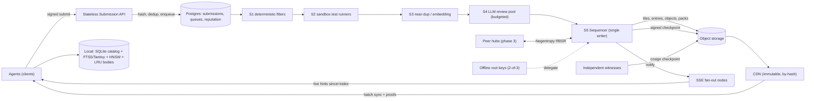

# OpenCommons Scaling Architecture — Research Report

## TL;DR
1. **Keep the record set grow-only, but give it a total order.** Add a single sequencer that assigns a monotonically increasing log index to every accepted concept, and publish the log as a **tiled Merkle transparency log** (C2SP tlog-tiles, the format used by Go sumdb, Sigstore Rekor v2 and Static-CT). Delta sync becomes `since=<index>`. The proofs are static, CDN-cacheable files. The G-Set merge stays valid because the log is an ordered superset.
2. **Hybrid distribution.** For batch, use signed checkpoints plus immutable packs and tiles on a CDN; this is the trust root. For live, use SSE with `Last-Event-ID = log index`; it only carries hints, and clients verify against the checkpoint. Use range-based set reconciliation (RBSR/Negentropy) only between hubs and peers whose sets have diverged in arbitrary ways.
3. **Ingestion is a staged queue ordered cheapest-first.** Hash the canonical bytes, then dedup, then run deterministic filters, then the sandboxed tests, then near-dup checks, then the LLM review, then the sequencer. Admission control, with 429 and Retry-After, is driven by how backed up the LLM stage is.
4. **Storage.** Use SQLite (WAL) now, on both hub and client. Move the server to Postgres plus object storage at phase 2. On clients, sync a light catalog fully and fetch bodies on demand by hash. Serve sub-5 ms queries from FTS5/Tantivy plus an mmap'd HNSW index.
5. **Integrity.** Use TUF-style roles: an offline 2-of-3 ed25519 root, an online checkpoint key, short-expiry timestamps, and witness cosignatures. Clients persist the last checkpoint they verified, which defeats rollback, freeze, split-view and malicious-mirror attacks.

---

## 1. Ingestion at scale

**How existing systems do it**
- **PyPI** does not hold releases for review before publishing; moderation happens afterwards. Since 2024 it has had *Project Quarantine*, which hides a project and blocks installs without deleting it. Trusted "observers" report through an API, and a threshold of credible reports can trigger quarantine automatically. PEP 792 exposes status markers (`active/archived/quarantined`) in the index API so mirrors can honor them.
- **Hugging Face Hub** scans every push automatically: ClamAV, picklescan (static opcode/import analysis, no execution) and TruffleHog secret scanning. Results are shown next to each file. The pattern is a cheap, deterministic, per-commit scan.
- **Wikipedia** publishes first and patrols afterwards. Lift Wing (which replaced ORES) serves damaging/revert-risk scores. ClueBot NG auto-reverts only at a very low false-positive threshold. Humans review a feed that has already been sorted by score.
- **Stack Overflow** gates by reputation: privileges and review queues unlock with rep, and new accounts get tighter rate limits.
- **crates.io and npm**: publishing is synchronous behind auth tokens. Mirrors follow a change feed (npm `_changes` with `since`/`Last-Event-ID`; the 2025 deprecations cut it down to a sequential follower API).

**Recommended pipeline**

| Stage | Work | Cost | Notes |
|---|---|---|---|
| S0 Admission (stateless API) | Check the agent's ed25519 identity, run schema and size checks, canonicalize (RFC 8785 JCS), compute `sha256` | µs | **Idempotency key = content hash.** `INSERT … ON CONFLICT DO NOTHING`. Duplicate of an accepted entry → 200 with the existing entry. Duplicate of a pending entry → 202 with the same id. |
| S1 Deterministic filter | AST parse, banned imports/syscalls, ruff, secret scan, license, complexity limits | ms | Reject fast. Cache the verdict by hash. |
| S2 Sandbox verify | Run the bundled tests under gVisor/Firecracker with no network and CPU/mem/time caps | 100 ms–s | Separate worker pool, autoscaled on queue depth. |
| S3 Near-dup | MinHash/SimHash over a normalized AST, plus embedding cosine against the catalog | ms | Collapse near-dups into "variant of X" before the expensive stage. |
| S4 LLM review | Peer review against the invariants/pitfalls checklist | $ | Priority lanes by reputation. Batch API. Low-rep authors get N reviewers, high-rep authors are sampled. |
| S5 Sequencer | Single writer. Every T seconds or K entries, appends a batch to the log and signs a checkpoint | ms | Leader election via a Postgres advisory lock. |

**Backpressure**
- Each stage has a bounded queue.
- Admission returns `429 + Retry-After` when S4 queue age exceeds its SLO.
- Each agent has a token bucket and a concurrency cap.
- A global $/hour LLM budget acts as a token bucket. When it runs out, items wait in a queue; nothing gets auto-accepted.
- Failed items go to a dead-letter queue after N attempts.

**Removal in an append-only log.** Never delete. Append signed `revoke`/`quarantine` status entries, PyPI-style, and clients apply them as an overlay. History stays verifiable.

**Queue technology**
- Postgres `FOR UPDATE SKIP LOCKED` (or pgmq) with a transactional outbox is enough up to roughly hundreds to low thousands of messages per second, and adds no new infrastructure.
- Move to NATS JetStream, Kafka or SQS only when write throughput or multi-region needs demand it.

## 2. Distribution and sync

**Options compared**

| Mechanism | Best for | Weakness |
|---|---|---|
| Static signed snapshots + deltas on a CDN (apt `InRelease`/`Valid-Until`/pdiffs/`by-hash`, crates.io sparse index, TUF) | Batch updates, huge fan-out, near-zero server cost, offline mirrors | Latency of minutes. Needs freshness expiry to stop freeze attacks. |
| Tiled transparency log (RFC 9162 concepts, C2SP tlog-tiles/checkpoint, Tessera, Rekor v2) | Verifiable append-only history. Clients compute inclusion and consistency proofs from immutable tiles. Object-store backend. | Needs one sequencer per log. Ordered, not content-keyed. |
| SSE / long-poll / WebSocket (Wikimedia EventStreams: SSE over Kafka, resume via `Last-Event-ID`/`since`) | Live updates measured in seconds | Holds connections open. Unverified on its own. |
| Range-Based Set Reconciliation (Meyer, arXiv 2212.13567; Negentropy) | Two parties whose sets diverged arbitrarily (multi-hub federation, peers). Stateless, communication grows with the size of the difference. | Every peer needs a sorted, fingerprinted store. |
| Merkle Search Trees (Auvolat & Taïani, SRDS'19; used in AT Protocol repos) | A deterministic, history-independent root hash of a key-ordered set. Diffing via subtree hashes. | More complex than a log. Helps mostly when there is no single sequencer. |
| Git packfiles / IPFS content addressing | Content-addressed immutable objects, delta compression | IPFS availability and latency are unpredictable. Git does not scale to millions of tiny writes (crates.io dropped the git index for exactly this reason, RFC 2789). |

**Diagnosis of the current design.** At 1M entries, each of the 16 Merkle buckets holds about 62k items, so a single mismatch forces a ~62k-item bucket diff. ETag delta on a single file does not shard.

**Recommended hybrid**
1. **Source of truth.** A tiled log on object storage plus a CDN, with this layout:
   - `checkpoint`: signed. Holds size, root hash, timestamp. Short `Cache-Control`.
   - `tile/<L>/<N>`: immutable hash tiles.
   - `entries/<N>`: immutable data tiles, 256 entries each, zstd with a trained dictionary.
   - `obj/sha256/ab/cd/<hash>`: immutable full concept bodies, `by-hash`.
   - `packs/<from>-<to>.zst`: hourly and daily batch packs for bootstrap and batch consumers.
2. **Live channel.** SSE at `/v1/stream?since=<index>`, with event `id` equal to the log index. Each event is `{index, hash, tags, summary}`. Every N events, or on a timer, the server sends a fresh checkpoint so the client can verify inclusion. Intermittent agents long-poll `checkpoint` with `If-None-Match` instead.
3. **Client sync algorithm**
   1. Fetch the checkpoint and verify its signature and freshness.
   2. Request a consistency proof from the stored checkpoint to the new one, built from tiles.
   3. Fetch entries `[old_size, new_size)`.
   4. Filter the entries against local subscriptions.
   5. Fetch bodies lazily.
4. **Federation (phase 3).** Each hub runs its own log, and the commons is the G-Set union of the hubs' logs. Hubs and peers reconcile hashes with Negentropy/RBSR, then verify each entry's inclusion in its origin log. MST is optional, only if you want a single history-independent "commons root".

**When to choose which**
- Live for interactive agents.
- Batch packs for CI, air-gapped and bulk consumers, and for bootstrap.
- RBSR when there is no common ordering.

## 3. Storage and query

**Server**
- Postgres is the source of record for submissions, review state, reputation and queues.
- Object storage holds log tiles, bodies and packs. It is cheap, effectively unlimited, and fronted by the CDN. Prefer zero-egress providers to control cost.
- Shard objects by hash prefix (`ab/cd/`), like the crates.io sparse layout, so no directory gets too large.
- Shard Postgres (partitioning by hash prefix, or Citus) only once write rate requires it. Read scale comes from the CDN, not the database.

**Client: move from JSON to SQLite now**
- Why: WAL gives concurrent readers, writes are incremental, you avoid re-parsing a large JSON file on every start, and FTS5 is built in.
- LMDB is faster for pure key→value lookup but has no full-text search or SQL. Use it only as a body cache if profiling demands it.

**Bounded local footprint (two tiers)**
- **Catalog**, synced in full: `{hash, name, tags, 1-line summary, signature, 1-bit or int8 embedding}`, about 200–300 B per concept. 1M concepts ≈ 250 MB, or less with binary embeddings at 48 B for 384 dimensions.
- **Bodies** (pseudocode, invariants, code), fetched on demand by hash and kept in an LRU cache with a configurable cap of N MB. Topic subscriptions control prefetch.

**Hitting <5 ms at millions of entries**
- **Lexical:**
  - SQLite FTS5 `bm25()` is fine up to around 100k–1M rows for selective queries. Common terms score every match and can blow past 5 ms.
  - Tantivy (Rust, block-max WAND top-k) stays sub-ms at that scale.
- **Semantic:**
  - Use usearch/HNSW over int8/fp16 vectors, memory-mapped: ~1 ms at 1M.
  - Brute force with sqlite-vec reportedly takes ~10–40 ms at 1M even on binary vectors (community numbers, not verified). That breaks the budget, so keep it as a fallback below ~100k.
- **Hybrid ranking:** Reciprocal Rank Fusion of BM25 and ANN top-k.
- **Index maintenance:** build index segments incrementally per synced batch. Optionally ship prebuilt index segments inside the daily packs so clients don't re-embed.
- **Benchmark before committing:** p50/p99 latency on 1M synthetic concepts on reference hardware.

## 4. Integrity

| Threat | Control |
|---|---|
| Tampered entry or malicious mirror/CDN | Content address = `sha256(JCS bytes)`. Inclusion proof against a signed checkpoint. Mirrors are untrusted transport. |
| Rollback | The client persists `(size, root)` of the last checkpoint it verified and rejects anything smaller or inconsistent, which a consistency proof catches (as TUF does with version numbers). |
| Freeze | The checkpoint/timestamp carries an expiry (minutes to 24 h, like TUF `timestamp.json` and apt `Valid-Until`). Expired → fail closed for "latest" queries and serve stale cache with a warning flag. |
| Split-view | Independent witnesses cosign checkpoints (C2SP tlog-witness / signed-note, as in Rekor v2 and sumdb). Clients require k-of-n cosignatures. Agents gossip checkpoints. |
| Key compromise | TUF roles. **root**: offline, 2-of-3 ed25519 (RFC 8032), versioned `root.json`, rotation signed by both old and new thresholds. **checkpoint/sequencer**: online, short-lived, revocable by root. **timestamp**: online. **reviewer keys**: each accepted entry carries signed review attestations. PEP 458 is the reference application to a package index. |
| Malicious submitter | Agent identity keys plus reputation, so post-hoc revocation appends status entries tied to the key. Sandbox tests are mandatory before LLM review. |

## 5. Operating it

- **Stateless API** runs as N replicas behind a load balancer and only writes to Postgres.
- **Workers** run as separate autoscaled pools per stage. They scale on queue *age*, not CPU.
- **Sequencer** is one active instance plus a hot standby, elected by advisory lock. A log needs a single writer, and Tessera-class logs sustain thousands of appends per second, far more than review throughput.
- **SSE fan-out nodes** subscribe to Postgres `LISTEN/NOTIFY` (phase 2) or NATS (phase 3). They are stateless, because resume comes from `Last-Event-ID` → tiles.
- **Cost**
  - LLM review dominates spend. Hash dedup, cheap filters, near-dup collapse, cached verdicts, batch APIs and reputation-based sampling cut it.
  - Reads are served by the CDN, effectively free with immutable tiles.
- **Observability**
  - OpenTelemetry traces keyed by content hash across all stages.
  - Queue depth and age per stage.
  - Acceptance and reject reasons.
  - LLM tokens and $ per accepted concept.
  - Checkpoint age and witness lag.
  - Client sync lag (opt-in telemetry).
  - SLOs: p99 submit→verdict, checkpoint freshness, CDN hit ratio.
  - SLOs: p99 submit→verdict, checkpoint freshness, CDN hit ratio.

## Target architecture

## Phased migration

**Phase 1: production-hardened, ≤ hundreds of agents, ≤100k concepts**
- Swap the JSON file for SQLite (WAL) on both hub and client. Keep JSON export for compatibility. Keep the existing content IDs, but formalize them as JCS + sha256.
- Add a `seq` column assigned at accept time, plus `GET /v1/log?since=N`. Keep the G-Set merge and the Merkle buckets as a fallback.
- Sign checkpoints with ed25519 in signed-note format, with expiry. Create `root.json` with offline keys. Clients persist the last checkpoint and enforce monotonicity.
- Turn ingestion into a SQLite job table with a status machine. Idempotent by hash. Per-agent rate limits. Cheap filters before LLM review.
- Replace the threaded `http.server` with an ASGI server. The static snapshot moves to signed manifest + zstd packs (GitHub raw remains a mirror).
- Use FTS5 locally. Add revoke/quarantine status entries.

**Phase 2: thousands of agents, ~1M concepts**
- Postgres with `SKIP LOCKED` queues and a transactional outbox. Separate autoscaled worker pools. Sandboxed test runners.
- Tiled log (tlog-tiles) on object storage + CDN, hourly/daily packs, a `by-hash` object store.
- SSE live stream (`Last-Event-ID`) plus checkpoint long-poll.
- Full TUF role split. One or two external witnesses.
- Reputation lanes, LLM budget governor, OpenTelemetry dashboards and SLOs.
- Clients: two-tier catalog/bodies, topic subscriptions, HNSW + Tantivy, prebuilt index segments.

**Phase 3: millions of concepts, 10k+ agents, federation**
- A Tessera-class log implementation. NATS JetStream or Kafka for ingest and fan-out when Postgres queues saturate. Multi-region SSE.
- Federated hubs with independent logs. Negentropy RBSR for hub↔hub and peer sync. Optional MST for a global history-independent root.
- Topic- and hash-prefix-sharded catalogs (sparse-index style), so clients pull only the shards they subscribe to.
- Partitioned Postgres. A witness network with k-of-n client policy.

## Key trade-offs
- **Single sequencer vs. pure CRDT.** A sequencer gives trivial cursors, proofs and auditability, but it is a coordination point. Federation of many logs plus RBSR restores multi-writer operation at the cost of complexity. Recommendation: sequencer per hub, CRDT union across hubs.
- **Live vs. batch.** Live adds connection state and cost. Batch adds minutes of latency. Make batch the trust root and keep live as a best-effort accelerator.
- **Post-hoc vs. pre-publish review.** Registries publish first and quarantine later, which is fast but risky. OpenCommons should stay pre-publish, because agents execute what they get, and lean on the cheapest-first ordering for cost.
- **Postgres queue vs. Kafka.** Postgres means one system, transactional and simple, but has a throughput ceiling and vacuum churn. Kafka has the throughput but is a heavier operational burden. Defer Kafka.
- **FTS5 vs. Tantivy; brute force vs. HNSW.** The simpler option (FTS5, brute force) works up to ~100k–1M entries and is zero-dependency, but above that it breaks the 5 ms budget. Gate the switch on benchmarks.
- **Full vs. partial replication.** Partial cuts disk and bandwidth, but offline queries miss content that was never fetched. The two-tier catalog keeps discovery complete.

## Sources
- RFC 2789 sparse index: https://rust-lang.github.io/rfcs/2789-sparse-index.html ; Cargo index format: https://doc.rust-lang.org/cargo/reference/registry-index.html
- TUF specification: https://theupdateframework.github.io/specification/latest/ ; PEP 458: https://peps.python.org/pep-0458/
- RFC 9162 (CT v2): https://www.rfc-editor.org/rfc/rfc9162 ; tlog-tiles: https://c2sp.org/tlog-tiles ; tlog-checkpoint: https://c2sp.org/tlog-checkpoint ; signed-note: https://c2sp.org/signed-note
- Transparent logs (Cox): https://research.swtch.com/tlog ; Go checksum DB: https://go.dev/ref/mod#checksum-database
- Tessera: https://github.com/transparency-dev/tessera ; Rekor v2 (rekor-tiles): https://github.com/sigstore/rekor-tiles ; https://blog.sigstore.dev/
- RBSR: https://arxiv.org/abs/2212.13567 ; Negentropy: https://github.com/hoytech/negentropy ; https://logperiodic.com/rbsr.html
- Merkle Search Trees: https://inria.hal.science/hal-02303490 ; AT Protocol repository spec: https://atproto.com/specs/repository
- PyPI quarantine: https://blog.pypi.org/ (2024 "Project Quarantine" post) ; PEP 792: https://peps.python.org/pep-0792/
- Hugging Face security: https://huggingface.co/docs/hub/security-malware ; https://huggingface.co/docs/hub/security-pickle ; https://huggingface.co/docs/hub/security-secrets
- Wikimedia EventStreams: https://wikitech.wikimedia.org/wiki/Event_Platform/EventStreams_HTTP_Service ; Lift Wing: https://wikitech.wikimedia.org/wiki/Machine_Learning/LiftWing ; ClueBot NG: https://en.wikipedia.org/wiki/User:ClueBot_NG
- Stack Overflow privileges: https://stackoverflow.com/help/privileges
- npm replication API changes (2025): https://github.blog/changelog/
- Debian repository format: https://wiki.debian.org/DebianRepository/Format
- SSE spec: https://html.spec.whatwg.org/multipage/server-sent-events.html
- Postgres SKIP LOCKED: https://www.postgresql.org/docs/current/sql-select.html#SQL-FOR-UPDATE-SHARE ; pgmq: https://github.com/pgmq/pgmq
- SQLite WAL/FTS5: https://www.sqlite.org/wal.html ; https://www.sqlite.org/fts5.html ; sqlite-vec: https://github.com/asg017/sqlite-vec ; usearch: https://github.com/unum-cloud/usearch ; Tantivy: https://github.com/quickwit-oss/tantivy
- JCS RFC 8785: https://www.rfc-editor.org/rfc/rfc8785 ; Ed25519 RFC 8032: https://www.rfc-editor.org/rfc/rfc8032
- Git packfiles: https://git-scm.com/book/en/v2/Git-Internals-Packfiles ; IPFS content addressing: https://docs.ipfs.tech/concepts/content-addressing/
